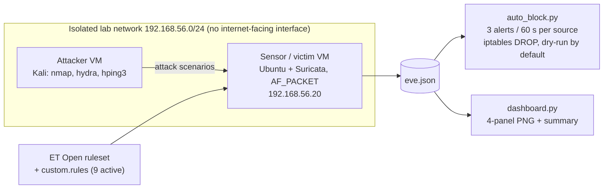
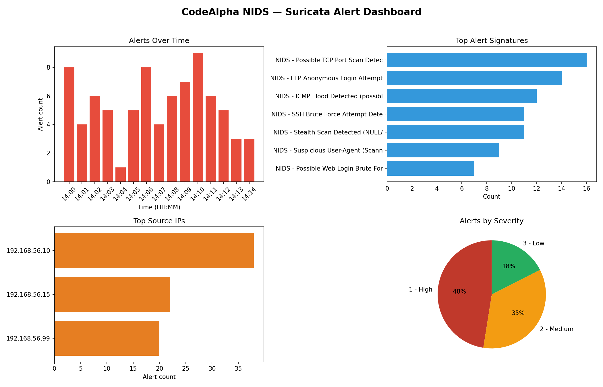

# Network Intrusion Detection System (Suricata lab)

> A Suricata-based network intrusion detection lab built during the CodeAlpha cybersecurity
> internship. It ships custom detection rules (port scans, brute force, ICMP flood, scanning
> tools…), attack scenarios to trigger them in an isolated lab, an automated response script that
> blocks repeat offenders with `iptables` (dry-run by default), and an alert dashboard.

## Problem

A default IDS ruleset is broad but generic: on a small lab network you also want rules for the
noisy reconnaissance and brute-force behaviour you actually expect, a way to prove each rule
fires, a first automated response, and a quick visual summary of the alerts. This project covers
those five points of the internship task: setup, custom rules, continuous monitoring, automated
response and visualization.

## Features

- **Custom Suricata rules** (`suricata/custom.rules`, sid 1000001 to 1000010):
  TCP port scan, stealth scan (NULL / FIN / Xmas), SSH brute force, ICMP flood, scanning-tool
  and automation User-Agents, web login brute force, anonymous FTP login, executable transfer
  (`MZ` header). The ARP-volume rule (sid 1000010) is kept but **disabled** (see
  [Limitations](#limitations)).
- **Config snippet** (`suricata/suricata.yaml.snippet`): `HOME_NET`, AF_PACKET capture,
  rule files (ET Open + custom rules), `eve.json` output.
- **Attack scenarios** (`attack-simulation/SCENARIOS.md`): one command per rule, run from the
  attacker VM, with the expected alert and a validation checklist.
- **Automated response** (`response/auto_block.py`): tails `eve.json`; when one source IP raises
  3 or more severity 1–2 alerts within 60 s (both configurable), it adds an `iptables` DROP
  rule. **Dry-run by default.**
- **Dashboard** (`dashboard/dashboard.py`): 4 panels (alerts over time, top signatures, top
  source IPs, severity breakdown) plus a console summary; `generate_sample.py` creates synthetic
  alerts to try it without Suricata.

## Architecture



| Path | Role |
| --- | --- |
| `suricata/custom.rules` | Custom detection rules |
| `suricata/suricata.yaml.snippet` | Sections to edit in `/etc/suricata/suricata.yaml` |
| `attack-simulation/SCENARIOS.md` | Lab test plan and validation checklist |
| `response/auto_block.py` | Automated response (`iptables`) |
| `dashboard/` | Dashboard, synthetic data generator, sample data and sample output |

## Results

| Item | Value | Source |
| --- | --- | --- |
| Custom rules written | 10 (sid 1000001–1000010) | `suricata/custom.rules` |
| Rules accepted by Suricata 7.0.3 (`suricata -T`, Ubuntu 24.04) | 9 active rules loaded, 0 errors; ARP rule disabled | syntax check, reproducible with the steps below |
| Full config check (ET Open via `suricata-update` + custom rules) | 53,441 rules loaded, 0 failed | same environment |
| Attack scenarios documented | 8, covering every rule except sid 1000009 | `attack-simulation/SCENARIOS.md` |
| Detection results in the lab (which scenarios fired) | *to be completed* | checklist in `SCENARIOS.md` is still empty |

The rows above only show that the rules **load**; they do not show that each rule **detects** its
attack. That evidence (filled checklist, `eve.json` excerpts) is not in the repository yet.

Sample dashboard, generated from **80 synthetic alerts** (`dashboard/sample_eve.json`, produced
by `generate_sample.py`), not from real traffic:



## Security

- **Dry-run first**: `auto_block.py` only prints the `iptables` command unless `--no-dry-run` is
  passed.
- **Limited response scope**: only severity 1 and 2 alerts count toward blocking, to avoid
  blocking on low-priority noise.
- **No shell interpolation**: `iptables` is called with an argument list (`subprocess.run`),
  so the source IP read from `eve.json` is never parsed by a shell.
- **No captured traffic in git**: `eve.json`, `*.pcap`, `*.log` and Suricata's `filestore/` are
  ignored. All IP addresses in the repository are private lab addresses.
- **Passive sensor**: Suricata runs in IDS (AF_PACKET) mode, not inline IPS.

To report a vulnerability, see [SECURITY.md](SECURITY.md).

## Installation

Lab: two VirtualBox VMs on an isolated internal network (`192.168.56.0/24`), an attacker
(Kali Linux) and a sensor / victim (Ubuntu Server, `192.168.56.20`).

### 1. Install Suricata (sensor VM)

```bash
git clone https://github.com/othmane1244/suricata-nids-lab.git
cd suricata-nids-lab
sudo apt update
sudo apt install -y suricata jq
sudo suricata-update     # downloads the Emerging Threats Open ruleset to /var/lib/suricata/rules
```

### 2. Add the custom rules

```bash
sudo cp suricata/custom.rules /etc/suricata/rules/custom.rules
```

### 3. Apply the config changes

Edit `/etc/suricata/suricata.yaml` with the sections shown in `suricata/suricata.yaml.snippet`:
`HOME_NET`, your capture interface, the two rule files and the `eve-log` output.

```bash
ip a    # find the interface attached to the internal network (often eth1)
```

### 4. Validate and start

```bash
sudo suricata -T -c /etc/suricata/suricata.yaml -v   # test the configuration
sudo systemctl enable --now suricata
sudo systemctl status suricata
```

### 5. Watch alerts

```bash
sudo tail -f /var/log/suricata/eve.json | jq 'select(.event_type=="alert")'
```

## Usage

### Attack scenarios

Follow [`attack-simulation/SCENARIOS.md`](attack-simulation/SCENARIOS.md) from the attacker VM
and watch the matching alerts in `eve.json` on the sensor VM.

### Automated response

```bash
# Simulation (default, does not touch iptables)
sudo python3 response/auto_block.py --eve /var/log/suricata/eve.json

# Live mode, once the logic has been checked
sudo python3 response/auto_block.py --eve /var/log/suricata/eve.json --no-dry-run

# Custom threshold and window
sudo python3 response/auto_block.py --eve /var/log/suricata/eve.json --threshold 3 --window 60
```

### Dashboard

```bash
python3 -m venv .venv && . .venv/bin/activate
pip install -r dashboard/requirements.txt

# Try it with the synthetic sample (no Suricata needed)
python3 dashboard/dashboard.py --eve dashboard/sample_eve.json -o sample_dashboard.png

# With real alerts
python3 dashboard/dashboard.py --eve /var/log/suricata/eve.json -o report.png

# Regenerate synthetic data (overwrites dashboard/sample_eve.json)
python3 dashboard/generate_sample.py
```

## Limitations

- **No recorded detection results yet**: the validation checklist is empty (*to be completed*);
  the only dashboard in the repository uses synthetic data.
- **ARP rule disabled** (sid 1000010): Suricata 7.0.3 rejects its `ether` / `ether.hdr` syntax.
  Suricata has no dedicated `arp` keyword; the rule needs to be rewritten, or ARP scans detected
  with an external tool such as arpwatch.
- **Executable-transfer rule** (sid 1000009) has no attack scenario and has not been tested.
- **Thresholds** (20 SYN / 10 s, 5 SSH SYN / 60 s, 50 ICMP / 5 s…) were chosen for the lab and
  are not tuned against real traffic.
- **Automated response**: no allowlist (a gateway or admin host that raises alerts can be
  blocked), blocks are never lifted automatically and are lost when `iptables` rules are
  flushed or the host reboots, and the sliding window uses the time each alert is read, not the
  `eve.json` timestamp.
- **User-Agent rules** are easy to evade by changing the User-Agent string.

## Ethical use

Built strictly for education, on an isolated lab network you own (VirtualBox internal network,
no internet-facing interface). **Every simulated attack targets only the lab victim VM.** Do not
run any scenario (especially the ICMP flood with `hping3` or the brute-force tests) against
systems you do not own or are not explicitly authorized to test.

## Context

CodeAlpha virtual cybersecurity internship (remote, self-directed, 2026), Task 4: Network
Intrusion Detection System. Designed and built independently in a personal isolated lab.

Author: Othmane Aliouali, AI & Cybersecurity engineering student, ENSA Béni Mellal.

## License

MIT, see [LICENSE](LICENSE).
